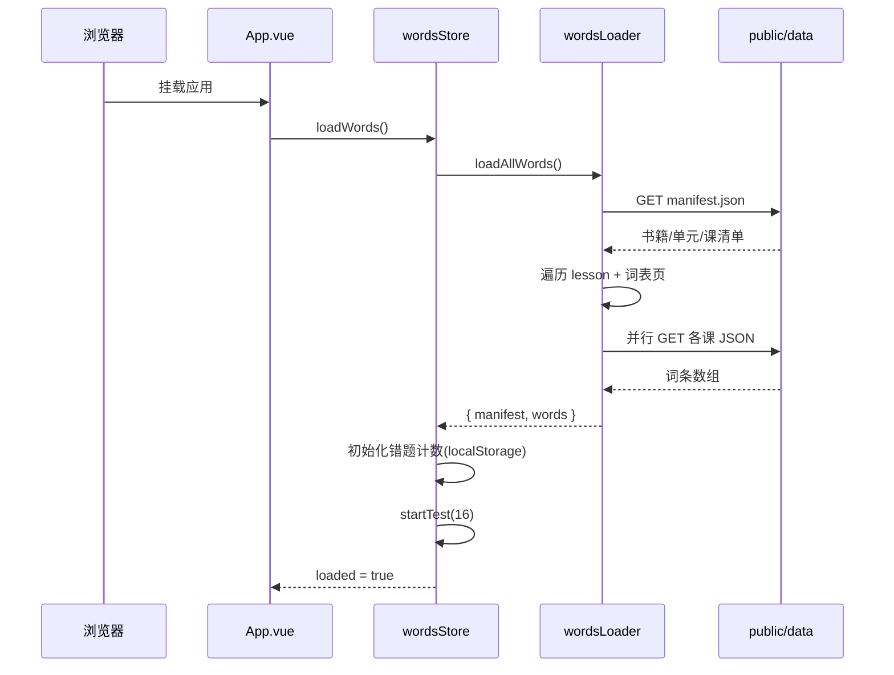
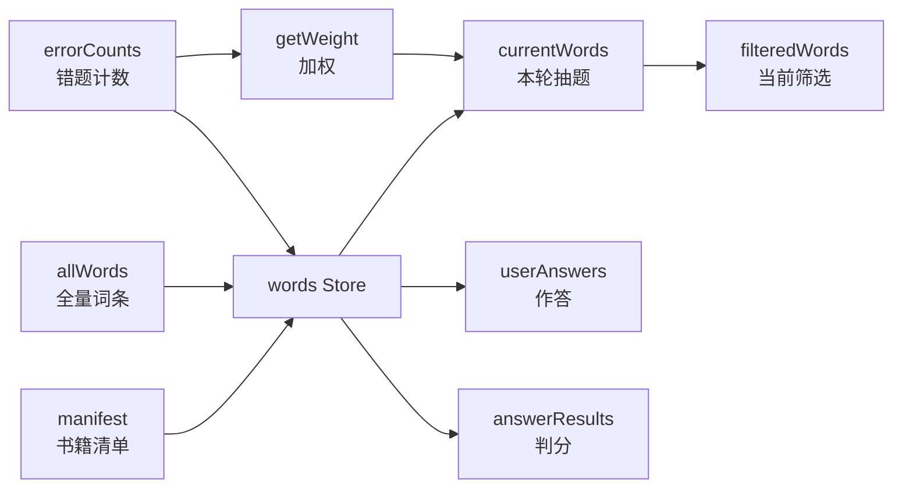
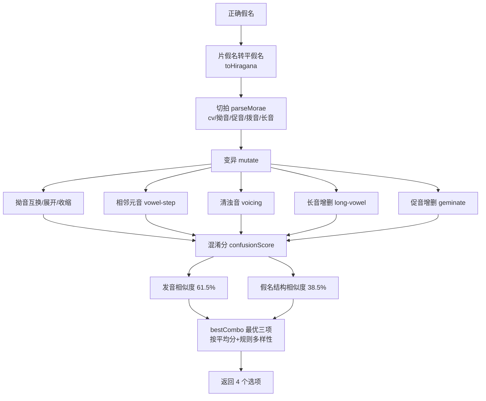

# 📖 日语学习 · 项目全景文档

> 一个按册、单元、课组织的中文学习者日语学习站点 —— 五十音图、单词练习、单词本、课文与语法，一应俱全。

<div align="center">


**在线访问** · [GitHub Pages](https://lcl-yn.github.io/japanese-learning/) · [Cloudflare Workers](https://japanese-learning.1141193930.workers.dev/)

</div>

---

## 📑 目录

1. [项目简介](#-项目简介)
2. [技术栈](#-技术栈)
3. [核心特性](#-核心特性)
4. [项目结构](#-项目结构)
5. [架构与数据流](#-架构与数据流)
6. [数据模型](#-数据模型)
7. [路由设计](#-路由设计)
8. [页面详解](#-页面详解)
9. [核心算法](#-核心算法)
10. [语音系统](#-语音系统)
11. [富文本编辑器](#-富文本编辑器)
12. [开发时保存机制](#-开发时保存机制)
13. [SEO 与无障碍](#-seo-与无障碍)
14. [响应式设计](#-响应式设计)
15. [测试](#-测试)
16. [扩展指南](#-扩展指南)

---

## 🎯 项目简介

**日语学习** 是一个纯前端、零后端的单页应用（SPA）。它把日语学习拆解为四个互相关联的模块：

| 模块 | 说明 | 路由 |
| --- | --- | --- |
| 🎵 五十音图 | 清音、浊音、拗音、符号、高低音，点击即读 | `/kana` |
| 📝 单词练习 | 看中文写日语 / 看日语写中文，自动判分 | `/study/:bookId/:unitId/:lessonId/practice` |
| 📚 单词本 | 按册单元课筛选、显隐中日文、搜索、朗读、考试 | `/words` |
| 📄 课文 & 语法 | 按课阅读富文本，开发时可编辑保存 | `/study/.../reading` · `/grammar` |

**核心理念**：练习、单词本、五十音图共用同一份 Pinia 词库；课文与语法共用同一套 Tiptap 富文本文档模型。

---

## 🛠 技术栈

| 类别 | 技术 | 版本 | 用途 |
| --- | --- | --- | --- |
| 框架 | **Vue 3** | ^3.5.44 | 组件化 UI，`<script setup>` 组合式 API |
| 语言 | **TypeScript** | ~6.0.3 | 全量类型约束 |
| 构建 | **Vite** | ^8.3.6 | 开发服务器 + 生产构建 |
| 路由 | **Vue Router** | ^4.6.4 | SPA 路由，历史模式 |
| 状态 | **Pinia** | ^4.1.0 | 单一词库 store |
| UI | **Element Plus** | ^2.14.8 | 表格、选择器、弹窗等组件 |
| 编辑器 | **Tiptap** | ^3.33.1 | 课文/语法富文本编辑 |
| 测试 | **Vitest** | ^5.1.0 | 单元测试，jsdom 环境 |

---

## ✨ 核心特性

- 🎌 **五十音图**：清音 / 拗音 / 浊音半浊音三张图，平假名与片假名逐格点击朗读；另有「符号」「高低音」知识卡片，调型用 SVG 折线可视化。
- 🧠 **错题加权抽词**：答错的词计数写入 `localStorage`，错得越多被抽中的机会越大，实现真正的「有的放矢」复习。
- 🔀 **假名混淆引擎**：为「手写选假名」题型自动生成读音相近的干扰项（拗音、长音、促音、清浊、相邻元音），混淆分基于拍级编辑距离。
- 🔊 **全方位语音**：单词本、五十音图、底部朗读条均使用 `speechSynthesis`，优先日语引擎；底部朗读条支持循环复读与拖拽。
- ✍️ **富文本编辑器**：课文与语法用 Tiptap 编辑，支持标题、字体字号、文字颜色、对齐、表格、引用、分割线、音频块，开发时可直接写回 JSON。
- 📱 **响应式**：≤959px 切换手机布局，顶栏滚动收起、目录抽屉化、朗读条收成气泡。
- 🔍 **SEO 完善**：动态 `title`/`description`/`canonical`/`og`/`twitter` 标签，逐课生成可区分的简介。

---

## 📁 项目结构

```
japanese-learning/
├── index.html                    # HTML 壳、SEO meta、JSON-LD
├── vite.config.ts                # Vite + Vitest 配置、base 解析
├── package.json
├── vite/                         # 开发服务器插件
│   ├── grammarSavePlugin.ts      #   课文/语法写回 JSON
│   ├── wordSavePlugin.ts         #   单词追加/修改写回 JSON
│   ├── wordSavePlugin.spec.ts
│   └── lessonAudioPlugin.ts      #   课文音频虚拟模块 + 目录监听
├── src/
│   ├── main.ts                   # 应用入口，装配 Pinia/Router/ElementPlus
│   ├── App.vue                   # 应用外壳：顶栏/侧栏/主区/底栏/朗读条
│   ├── router/index.ts           # 路由表
│   ├── stores/words.ts           # 词库 Pinia store（核心状态机）
│   ├── types/                    # word.ts / grammar.ts 类型定义
│   ├── services/                 # 数据加载与保存
│   │   ├── wordsLoader.ts        #   词库清单 + 各课 JSON 并行加载
│   │   ├── grammarLoader.ts      #   课文/语法文档加载与保存
│   │   └── wordSave.ts           #   单词追加/修改接口
│   ├── utils/                    # 纯函数工具（含算法与测试）
│   │   ├── answerCheck.ts        #   答案判分
│   │   ├── weightedRandom.ts     #   错题加权随机抽取
│   │   ├── examChoices.ts        #   看日语选中文干扰项
│   │   ├── examQueue.ts          #   无重复抽题队列
│   │   ├── examSound.ts          #   提示音预解码播放
│   │   ├── kanaConfusion.ts      #   假名混淆引擎 ⭐
│   │   ├── cnSearch.ts           #   中文释义前缀搜索
│   │   ├── speech.ts             #   speechSynthesis 封装
│   │   ├── grammarDocument.ts    #   文档模型校验 + 路径
│   │   ├── grammarOutline.ts     #   标题目录树
│   │   ├── lessonAudio.ts        #   课文音频路径/排序/播放
│   │   ├── wordAppend.ts         #   单词写回校验
│   │   ├── wordDisplay.ts        #   展示文案
│   │   ├── unitPages.ts          #   单元页词表判定
│   │   ├── quoteEnter.ts         #   Tiptap 引用回车扩展
│   │   └── seo.ts                #   动态 SEO
│   ├── data/kana.ts              # 五十音图数据
│   ├── components/               # 14 个组件
│   └── views/                    # 7 个页面
├── public/                       # 静态资源（直接以路径访问）
│   └── data/
│       ├── words/                #   词库清单 + 各课词表 JSON
│       ├── reading/              #   课文文档 JSON
│       ├── grammar/              #   语法文档 JSON
│       └── audio/                #   课文音频 m4a
└── docs/                         # 算法说明文档、提示音素材
```

---

## 🏗 架构与数据流

### 启动与词库加载



### 状态管理（Pinia `words` store）



核心 store 状态：

| 字段 | 类型 | 说明 |
| --- | --- | --- |
| `manifest` | `WordsManifest` | 书籍清单（含 code/name/level/volume/units） |
| `allWords` | `Word[]` | 全量词条，带 `bookId/unit/lesson` |
| `currentBookId/UnitId/LessonId` | - | 当前筛选范围（`all`/`0` 表示不缩） |
| `mode` | `'cn2jp' \| 'jp2cn'` | 练习方向 |
| `currentWords` | `Word[]` | 本轮抽中的词 |
| `userAnswers` | `PracticeAnswer[]` | 用户作答 |
| `answerResults` | `PracticeResult[]` | 判分结果 |
| `errorCounts` | `Record<string, number>` | 错题计数（持久化） |
| `examPool` | `Word[] \| null` | 单词本考试临时词池 |

---

## 🗂 数据模型

### 单词 `Word`

```typescript
interface Word {
  cn: string            // 中文释义
  jp: string            // 日语假名
  jp_write: string      // 日语手写（汉字等）
  describe: string      // 单词说明
  part_of_speech: string// 词性
  scale: string         // 东京音高低（⓪①…，查不到为空）
  bookId: string        // 册代号
  unit: number          // 单元号
  lesson: number        // 课号
  fileIndex?: number    // 课次 JSON 数组下标（仅内存）
}
```

### 清单 `WordsManifest`

```typescript
interface WordsManifest {
  books: BookMeta[]     // code / name / level / volume / units
}
interface UnitMeta {
  unit: number
  name: string
  lessons: LessonMeta[]     // id / lesson / name / file
  pages?: UnitPageMeta[]    // 单元末独立页（如「词语之泉」）
}
```

**设计要点**：路由与筛选用 `code`、`unit`、`lesson`，不用数据库主键 `id`；词条 JSON 本身不写册/单元/课字段，这些信息由清单注入（`wordsLoader.toWord`）。

### 富文本文档 `GrammarDocument`

课文与语法共用 ProseMirror/Tiptap 的 JSON 文档模型（`type: 'doc'` + `content[]`），通过严格的校验函数 `isGrammarDocument`（限制节点数 5000、深度 30、属性数 20 等）保证写入安全。

---

## 🧭 路由设计

| 路由 | 页面 | 说明 |
| --- | --- | --- |
| `/` | → `/kana` | 重定向 |
| `/kana` | 五十音图 | 支持 `?topic=marks\|pitch` |
| `/words` | 单词本 | 筛选不带动左侧目录 |
| `/study/:bookId/:unitId/:lessonId/practice` | 单词练习 | 当前课抽词作答 |
| `/study/:bookId/:unitId/:lessonId/reading` | 课文 | 开发可编辑，打包只读 |
| `/study/:bookId/:unitId/:lessonId/grammar` | 语法 | 同上 |
| `/study/:bookId/:unitId/page/:pageId` | 单元末页 | 与课同级的独立页面 |

> 地址中的 `bookId` 是清单上的 `code`，`unitId`/`lessonId` 是清单上的 `unit`/`lesson`。

---

## 🖥 页面详解

### 应用外壳 `App.vue`

```
┌──────────────────────────────────────────┐
│  顶栏（滚动收起 / 窄屏抽屉菜单）            │
├──────────┬───────────────────────────────┤
│ 侧栏目录 │  面包屑 + 主区（RouterView）    │
│ 五十音图 │                                │
│ 单词本   │                                │
│ 册→单元  │                                │
│ →课→课文 │                                │
│ /语法    │                                │
├──────────┴───────────────────────────────┤
│  底栏 SITE_NAME · SITE_TAGLINE            │
└──────────────────────────────────────────┘
        ↕ 底部浮动朗读条 JapaneseSpeaker
```

- 顶栏滚动收起：窄屏往下滚收起、往上滚/回顶展开，带 250ms 防抖锁。
- 目录联动：跨课切换保持已展开的册/单元/课；进单词本或五十音图时目录收起。
- 目录在窄屏改为 `el-drawer` 抽屉。

### 五十音图 `KanaView`

三个子区块（`chart` / `marks` / `pitch`），通过 `?topic` 查询参数切换，缺省回 `chart`。

- **基本 50 音**：11 行 × 5 列，每格平/片假名各一个按钮，点击朗读。
- **符号**：浊音符号 `゛`、半浊音 `゜`、长音 `ー`、小ケ `ヶ`、重复 `々` 的说明表。
- **高低音**：0 调～3 调四张卡片，SVG 折线标注高音（橙）与低音（灰）。

### 单词练习 `PracticeView` + `PracticeSession`

- 两个模式：**看中文写日语**（假名 + 手写两格）、**看日语写中文**（一格）。
- 表格两列排版（`wordPairs` 两两配对）。
- 提交后逐格判分，正确率 / 正确数 / 总数统计。
- 「开始新测试」重抽 16 题；「清除错题统计」重置加权。

### 单词本 `WordsView`

- 册 → 单元 → 课三级筛选 + 中文释义前缀搜索（按逗号/顿号/分号拆义项）。
- 三个显隐开关：中文 / 日文 / 假名。
- **考试模式**：把当前列出的词开考，可返回词表。
- **开发模式**：添加 / 修改单词对话框，写回 JSON。

### 课文/语法 `LessonDocumentView`

- 宽屏：正文（8fr）+ 右侧标题目录（2fr）；窄屏：顶栏「笔记目录」按钮，底部弹出。
- 开发可编辑：点「编辑」进入 Tiptap，保存走 `PUT` 接口；离开前有未保存确认。
- 无内容时显示「这一课还没有课文/语法」。

---

## 🧮 核心算法

### 1. 错题加权随机 `weightedRandom.ts`

```typescript
// 权重 = 1 + 错题次数，错得越多越容易被抽中
getWeight(word) { return 1 + (this.errorCounts[wordKey(word)] || 0) }
```

`selectRandomWordsWithWeights` 使用**按权重轮盘**抽取，抽中后从总权重中减去并标记，避免重复；词数不足时用 Fisher-Yates 洗牌补足，最终再整体洗牌。

### 2. 假名混淆引擎 `kanaConfusion.ts` ⭐

「手写选假名」题型的干扰项生成器，是全项目最精密的算法模块：



- **发音相似度**：拍编辑距离（0.25）+ 元音距离（0.2）+ 辅音距离（0.2）+ 长音差异（0.15）+ 促音差异（0.1）+ 拗音形态（0.1）。
- **结构相似度**：字符编辑距离 + 同位命中 + 长度 + 拍结构 + 特殊形态。
- **最优组合**：在 Top-12 候选中枚举三选，取「平均混淆分 × 0.45 + 规则多样性 × 0.2 + 高分带 × 0.15」最大者；不足时逐级降低混淆分门槛（0.72 → 0.6 → 0.45 → 0.3）。

### 3. 选择题 `examChoices.ts`

「看日语选中文」：一个正确释义 + 三个从整本词库随机抽的互异错误释义，Fisher-Yates 洗牌。

### 4. 无重复抽题 `examQueue.ts`

本轮未出过的词优先，全部出完再洗牌；新一轮首题不与上题紧邻。`prepare` 返回 `null` 的词（凑不齐选项）跳过不占题。

---

## 🔊 语音系统

| 模块 | 文件 | 说明 |
| --- | --- | --- |
| 语音列表 | `utils/speech.ts` | `loadVoices` 优先日语引擎，无则列全部 |
| 日语朗读 | `utils/speech.ts` | `speakJapanese`，未选时只设 `lang=ja-JP` |
| 底部朗读条 | `JapaneseSpeaker.vue` | 输入→朗读、循环复读（间隔 1s）、拖拽 |
| 提示音 | `utils/examSound.ts` | Web Audio API 预解码，避免手机延迟 |
| 课文音频 | `utils/lessonAudio.ts` | 路径校验、按课号/类型排序、播放占用 |

**底部朗读条细节**：默认读一次，选循环则读完隔 1 秒再读；窄屏收成右下角气泡；按住左侧手柄可拖动，切换页面时位置/输入/音色保持；连续触发只读最后一次（防 Chrome 吞句）。

**提示音细节**：`warmExamSounds` 提前 fetch 并 `decodeAudioData` 进内存，`unlockExamSounds` 在点击处理里同步唤醒 `AudioContext`，未就绪时降级用 `new Audio()` 兜底。

---

## ✍️ 富文本编辑器

`GrammarEditor.vue` 基于 Tiptap，支持：

- **段落样式**：正文 / 一级～四级标题。
- **字体字号**：微软雅黑、宋体、黑体、楷体、游ゴシック；12px～28px。
- **文字颜色**：10 列 × 5 行共 50 个预设色 + 系统取色器。
- **对齐**：左 / 中 / 右 / 两端，SVG 图标实时反映当前状态。
- **表格**：10×8 点选 + 自定义行列（1～20），支持列宽拖动、右键菜单（插行/列、删行/列/表）。
- **其它**：加粗/斜体/下划线/删除线、无序/有序列表、引用、分割线、**课文音频块**。

自定义扩展：

| 扩展 | 文件 | 作用 |
| --- | --- | --- |
| 引用回车 | `utils/quoteEnter.ts` | 引用内空段回车不抬出引用 |
| 音频块 | `lessonAudioExtension.ts` | 叶子节点，渲染为 `LessonAudioPlayer` |

---

## 🔧 开发时保存机制

生产环境是纯静态站点（只读），编辑保存能力完全由三个 **Vite 开发服务器插件** 提供（`apply: 'serve'`）：

| 插件 | 接口 | 功能 |
| --- | --- | --- |
| `grammarSavePlugin` | `PUT /__grammar` · `PUT /__reading` | 课文/语法文档写回 `public/data/…` |
| `wordSavePlugin` | `PUT /__words` · `PUT /__words/edit` | 单词追加/修改写回词表 JSON |
| `lessonAudioPlugin` | 虚拟模块 `virtual:lesson-audio` | 扫描音频目录 + 监听增删热更 |

**安全设计**：所有写操作都做路径校验 —— 书籍/页面 id 仅允许小写字母数字连字符，`path.relative` 后必须仍在 `public/data/words`（或 `reading/grammar`）内，拒绝 `..` 和绝对路径；写入有字节上限（课文 512KB、单词 32KB）；`wordSavePlugin` 用队列串行化写入，避免并发读旧文件互相覆盖。

---

## 🔎 SEO 与无障碍

- `utils/seo.ts` 按面包屑动态生成 `title`、`description`、`robots`、`canonical`、`og:*`、`twitter:*`。
- 课文/语法路由 `robots: noindex,follow`；练习/五十音图/单词本可收录。
- `index.html` 内置完整 meta 与 JSON-LD，保证未执行脚本的抓取器也能读到。
- 无障碍细节：`#main` 跳转链接、`aria-label`/`aria-pressed`/`aria-expanded` 齐备、`prefers-reduced-motion` 关闭动效、焦点可见轮廓。

---

## 📱 响应式设计

断点 **959px**，覆盖以下行为：

| 区域 | 宽屏 | 窄屏（≤959px） |
| --- | --- | --- |
| 底栏 | 显示 | 隐藏 |
| 侧栏目录 | 固定 248px | `el-drawer` 抽屉 |
| 顶栏 | 固定 | 滚动收起 / 回顶展开 |
| 朗读条 | 底部居中 | 收成右下角气泡，展开后输入框独占一行 |
| 课文目录 | 右侧固定 | 顶栏「笔记目录」底部弹出 |
| 单词本 | 表格 | `WordMobileBoard` 卡片板 |

---

## 🧪 测试

Vitest + jsdom，纯函数与组件测试并存，`passWithNoTests` 允许空测试文件：

```
src/stores/words.spec.ts
src/services/{wordsLoader,grammarLoader,wordSave}.spec.ts
src/utils/{answerCheck,cnSearch,examChoices,examQueue,examSound,
           grammarDocument,grammarOutline,kanaConfusion,lessonAudio,
           quoteEnter,seo,speech,unitPages,weightedRandom,wordAppend,
           wordDisplay}.spec.ts
vite/wordSavePlugin.spec.ts
```

```bash
npm run test:unit     # 运行一遍
npm run test:watch    # 监听重复运行
```

---

## 🚀 扩展指南

### 新增一课

1. 在对应册目录新增词表 JSON，如 `public/data/words/beginner-upper/lesson-03.json`：

```json
[
  {
    "cn": "明天",
    "jp": "あした",
    "jp_write": "明日",
    "describe": "",
    "part_of_speech": "名词"
  }
]
```

2. 在 `manifest.json` 对应单元的 `lessons` 登记（`file` 相对 `public/data/words/`）：

```json
{
  "id": 3,
  "lesson": 3,
  "name": "第3课",
  "file": "beginner-upper/lesson-03.json"
}
```

3. 刷新页面即可。没有课的单元目录显示「暂无课」。

### 新增五十音知识点

在 `KanaView.vue` 的 `kanaSections` 数组加一条 `{ id, label }`，再在模板里按 id 展示。

---

## 📦 本地开发

```bash
npm install
npm run dev          # 开发服务器，默认 http://localhost:5173/
npm run test:unit    # 单元测试
npm run build        # vue-tsc -b 类型检查通过后 vite build
npm run preview      # 预览生产构建
```

---

<div align="center">

**—— 全文完 ——**

*本文档基于 `japanese-learning` 源码自动梳理生成，涵盖了项目结构、架构、算法与工程细节。*

</div>
